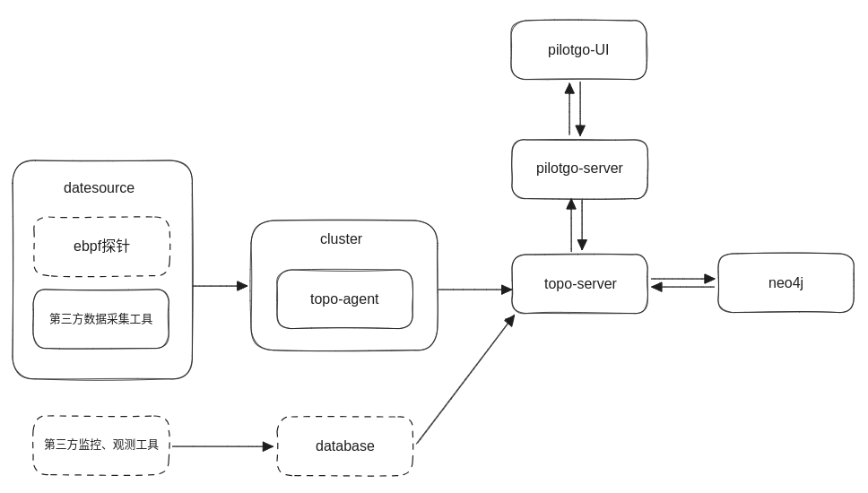
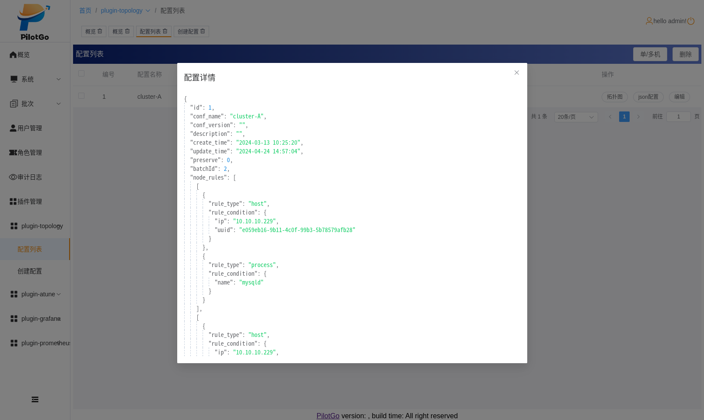
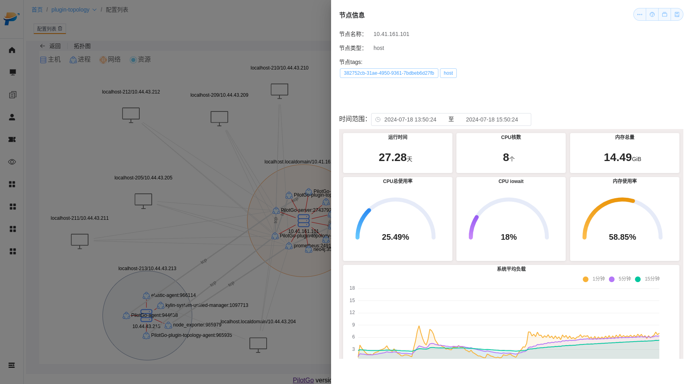

English | [简体中文](./README.md)

# PilotGo-plugin-topology

#### Introduction
System application architecture detection.

#### Software Architecture
1. System environment: 
- agent: Kylin-Server-V10-SP3, nestos, openEuler-22.03-LTS-SP1
- server: Kylin-Desktop-V10-SP1, Kylin-Server-V10-SP3, nestos, openEuler-22.03-LTS-SP1, redhat9
2. Development tools:
- golang >= 1.18, vue3, typescript, node.js > 14
3. Runtime dependency components:
- PilotGo
- neo4j(jvm)
- mysql
- redis







#### Installation and Usage Tutorial
work directory: PilotGo-plugin-topology/
1. Clone the repository
```bash
$ git clone https://atomgit.com/openeuler/PilotGo-plugin-topology.git
```
2. Modify the configuration files
```bash
$ mv topo_server.yaml.templete topo_server.yaml; vim topo_server.yaml
$ mv topo_agent.yaml.templete topo_agent.yaml; vim topo_agent.yaml
```
3. Build the frontend
```bash
$ cd ./web
$ yarn install
$ yarn build
```
4. Build the backend
```bash
$ go build -mod=vendor -o topoagent agent/main.go
$ mv web/dist/* server/handler/
$ go build -mod=vendor -tags=production toposerver server/main.go
```
5. Run
```bash
Start PilotGo and its related middleware and the neo4j database on the management node;
$ ./toposerver -conf /path/to/topo_server.yaml
Deploy topoagent and topo_agent.yaml to the corresponding directory on the service node;
$ ./topoagent -conf /path/to/topo_agent.yaml
```
6. Open the PilotGo web UI page, add and start the topology plugin, then view the topology page

#### Development
- gitee.com/openeuler/PilotGo-plugin-topology/server/agentmanager Plugin cluster agent management module
- gitee.com/openeuler/PilotGo-plugin-topology/server/db Database management module, including neo4j, mysql and redis
- gitee.com/openeuler/PilotGo-plugin-topology/server/errormanager Exception management module
- gitee.com/openeuler/PilotGo-plugin-topology/server/generator Topology generator module, including graph data collection and processing
- gitee.com/openeuler/PilotGo-plugin-topology/server/graph Topology element module, including nodes and edges
- gitee.com/openeuler/PilotGo-plugin-topology/server/logger Log management module (inherited from the PilotGo plugin SDK)
- gitee.com/openeuler/PilotGo-plugin-topology/server/pluginclient Plugin client module (inherited from the PilotGo plugin SDK)
- gitee.com/openeuler/PilotGo-plugin-topology/server/signal System signal handling module, including process termination signals
